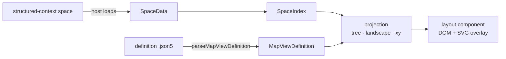

# Architecture

Space data and a definition go in; a DOM layout with an SVG overlay comes out. The browser's layout engine (Flexbox, Grid, absolute positioning) does the spatial work; there is no custom layout engine and no intermediate scene graph.

## Modules

| Module | Holds | May import |
|---|---|---|
| `src/map-views/core` | Definition parsing and validation, parameter resolution, the space index, and the projections (`buildTree`, `buildLandscape`, `buildXYPlot`) | Types from structured-context only. No React, DOM or Node |
| `src/map-views/layouts` | `MapView`, the layout components, `NodeCard`, `EdgeOverlay`, `ParameterControls`, styles | core, React |
| `src/map-views/node` | `loadMapViewDefinitions`: finding definitions in the library, plugins and config folders | core, Node, structured-context |
| `src/navigator` | The standalone host: a Vite app plus dev-server middleware calling the structured-context API | Anything |

`tests/module-boundaries.test.ts` enforces the core and layouts rules, including that neither imports the Node module. Core runs anywhere (browser, Node, worker) and is tested without a DOM, against fixtures captured from spaces (`tests/fixtures/`, written by `scripts/capture-fixtures.ts`). The public sample space in `samples/launch-playbook/` is the source of `launch-playbook.json`.

## Data in

Hosts load spaces on the Node side and pass the library `SpaceData`: the schema id, the hierarchy and the nodes with their resolved parents. `buildSpaceIndex` turns that into a `SpaceIndex`: nodes keyed by id, and every hierarchy and relationship edge with its metadata (field, which side declares it, hierarchy or relationship), readable in both directions. Edges to nodes outside the data are dropped, so a filtered space stays consistent.

## Projections

Each layout has a pure projection in core that turns the index and the region's resolved settings into occurrences and links:

- **Tree**: walks the hierarchy from the root type. A node with several parents is repeated (subtree once) or placed once with cross-links. Cycles end in a repeat.
- **Landscape**: walks the grouping levels, joining node levels by edges in either direction, through `via` chains or by field values.
- **XY**: normalises two numeric fields to percentages within each axis's domain and lists the nodes it can't place.

Occurrence keys are paths (region, ancestors, node), so a node appearing several times gets distinct keys.

## Rendering

Layout components render occurrences as DOM, sizing to their container rather than the viewport. Data-driven positions (XY coordinates) are inline styles; everything else is Tailwind utilities.

Connectors are drawn by `EdgeOverlay`: a single `<svg>` over the layout container. Each layout keeps a map from occurrence key to element (marked with a `data-occurrence` attribute), measures source and target with `getBoundingClientRect`, and redraws when the container resizes (`ResizeObserver`). DOM `id`s aren't used, so several map views can render side by side.

## Styling

Utilities use Tailwind with the `mv` prefix and no preflight, so nothing global leaks into the host. They are deliberately unlayered: host CSS outside a cascade layer beats anything inside one, and an Obsidian `button { … }` rule would otherwise override them. For the same reason, components avoid native elements that hosts style globally (cards are `div role="button"`, not `<button>`).

Hosts theme map views through six variables: `--mv-color-surface`, `--mv-color-card`, `--mv-color-ink`, `--mv-color-muted`, `--mv-color-edge` and `--mv-color-accent`.

## Hosts

- **Navigator** (`src/navigator`): dev-server middleware serves spaces (from the structured-context config, plus the fixtures as `fixture:<name>`) and the definitions `loadMapViewDefinitions` finds, as JSON. Selecting a node opens a side panel with its fields. Parameter values live in memory.
- **Obsidian plugin** ([obsidian-structured-context](https://github.com/mindsocket/obsidian-structured-context)): renders map views in a pane, builds the data in-process, opens the source note on selection and keeps parameter values in the view state.
